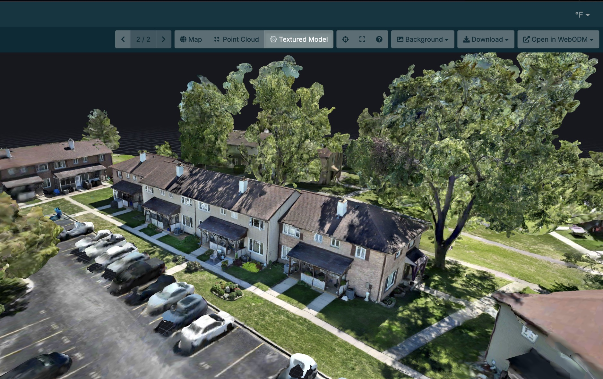

# Explorer

A plugin for [WebODM](https://github.com/WebODM/WebODM) 4.0.1 and later, to browse a project's outputs and share
its maps, point clouds, textured models and Gaussian splats with links that open without a WebODM account or login.
Experimental: it is not part of WebODM and not made by WebODM's authors.

The documentation is at **https://winuxnomacs.github.io/webodm-explorer/** (its sources in [docs/](docs/)):
[Getting Started](docs/getting-started.md) and guides to [Explorer's home](docs/guide/projects.md),
[a project's page](docs/guide/project.md), [the viewers](docs/guide/viewers.md), [sharing](docs/guide/sharing.md) and
[administration](docs/guide/administration.md), [Security](docs/hosting/security.md) (read it before exposing WebODM
to the internet: why WebODM's own protection isn't enough, what to put in front of it, and references to OWASP, NIST,
CIS and Mozilla), and [Hosting on Linode](docs/hosting/linode.md): a script that sets up a server where only Explorer's
links are public.

## Features

- **Explorer** in the main menu opens a drop-down: **Projects** and **Sharing Center**. **Projects** lists the projects you can view (WebODM's admins: every project), with **Search Projects & Tasks**
  (projects' names, descriptions and tags and their tasks' names, filtering as you type from the second letter; a
  project found by a task's name shows that task, and List view opens on Search Results: every project's matching
  tasks under its name), **All**, **Mine** or **Shared with Me**, sorting by **Recent Activity**, **Name**
  or **Created**, and **Has 3D** and **Shared by Link** filters, 24 projects to a page; the page's address keeps
  them, so a view can be bookmarked. Each card shows the project's picture, description, tags, a count per output
  type, its last activity, its owner when it isn't you, and its active links (marked when one expires within 7 days)
  for users who can share it. **List** shows them like a file browser: the projects by name on the left, the
  selected project's details, options and task rows (each opening its task page) on the right, switched in place,
  with Up and Down keys and Back to Projects on a phone. **Map** shows the projects where their tasks were flown, over
  WebODM's basemap. On a computer the home opens in List, or the view each user last chose; on a phone always in Grid.
- **A project's Explorer page** has the owner, tags and task count, an **Overview Map** of the tasks' footprints
  (folded when there is one task; a footprint opens its task), and a card per completed task with outputs: its
  thumbnail, date, images, size and processing time, tags, and buttons for its **Map** (orthophoto, DSM, DTM, thermal),
  **Point Cloud**, **Textured Model** and **Gaussian Splats**. The thumbnail and name open **the task's page**: its
  views, Download, Open in WebODM, **Processing Report**, a **Footprint** map, **Processing Details** (images, time,
  size, node and processing options) and **Previous** / **Next**; through a link and View as Visitor, the same without
  the node and WebODM's pages, with Download only on links that allow it and the report only on links with Allow All
  Task Files. These open in Explorer's own viewer, with a
  **Download** menu and **Open in WebODM** (WebODM's map and 3D pages, for their measurement tools); each card's
  "..." menu has the same. The page's "..." menu has **Open in Dashboard** and **View All on Map**. Where WebODM
  can't make a thumbnail (a thermal orthophoto, or a task with elevation models only), the card draws one from the
  task's map tiles, in the colours of its map.
- **View as Visitor** on a project's Explorer page shows the project as anyone with a link sees it (the link page,
  its maps and 3D views, with tiled models), without creating a link, for any signed-in user who can view the
  project.
- **Share** on a project's Explorer page shows and copies the page's link. It opens only for signed-in users the
  project is shared with (Dashboard: the project's Edit dialog, Permissions).
- **Anyone with the Link**, in the Share panel for users who can change the project: links that open the project
  without signing in, each with a label and an expiry (7, 30 or 90 days, or never), copied again, edited (label and
  expiry) or revoked at any time, or opened with **Open** to see them as visitors do. A link opens a page of the project's tasks, each with a **Map** and a 3D
  view of its **Point Cloud** (streamed node by node from WebODM's EPT, within the point budget WebODM's own 3D page
  uses: 10 million points on a computer, 2 million on a phone, 1 million on iOS), **Textured Model** and **Gaussian
  Splats**. The textured model streams as 3D Tiles (only what is on screen, finer close up), which Explorer builds
  from the task's mesh in WebODM's worker the first time it is shared or opened (a minute or two per mesh, at low
  priority, one at a time, kept in the task's own folder in WebODM's media, so they survive upgrades); until they are
  ready, the link shows WebODM's own model. A link serves only what these views stream, unless it has
  **Allow Downloads** (ticked when creating it, or on the link later): its task cards and views then get a **Download** menu
  with the orthophoto, DSM, DTM, point cloud (LAZ) and textured model (zip and glTF); with **Allow All Task Files**
  too, the rest of WebODM's Download menu: the Quality Report, camera shots and parameters, the other formats and
  All Assets (which includes each photo's position and capture time and the processing log). With **Allow Source Photos**, its map and 3D pages have Source Frames: the task's photos,
  re-encoded without their EXIF data (the original photo only with Allow Downloads too). A link with **Require Sign-In** asks for a WebODM login first (any account on the WebODM,
  without sharing the project with it), and has no preview in chat apps. Links are kept in plain text in WebODM's
  database (so they can be copied again), and revoking one, or unticking Allow Downloads, Allow All Task Files or Allow Source Photos, takes effect at once.
- **The Sharing Center** (Explorer > Sharing Center) manages every link of the projects you can change in one place
  (WebODM's admins: every project's): a table with each link's project, label, **Require Sign-In**, its file options (**Allow
  Downloads**, **Allow Source Photos**, **Allow All Task Files**), when it was made and by whom, and its expiry, filtered by status (**Active**, **Expiring Soon**,
  **Expired**), project, access and downloads, or searched by label, project or user, the filters kept in the page's
  address. **Create Link** makes a link for any of those projects; each link has **Open**, **Embed**, **Copy**,
  **Edit** and **Revoke**. Expired links stay listed for 90 days, with **Renew** (a new expiry, and the same address
  works again) and **Delete**. On a phone or in a narrow window the rows become cards.
- **Explorer's map and 3D pages** (for visitors and signed-in users alike) have **Previous** and **Next** to step
  through the project's tasks, keeping the view where the next task has it, a switch between the task's **Map** and
  its 3D views, **Reset View** (R) and **Fullscreen**
  (F, where the browser allows it). Switching the 3D page between Point Cloud, Textured Model and Gaussian Splats
  keeps the camera where you left it. The 3D page explains its controls ("?"), turns to orbit a point you double-click
  or double-tap, and gives the point cloud a **Point Size** and **Colour by Elevation** with a legend. The map has a
  **layer opacity** slider over the basemap and a scale bar in the legend's units. The 3D page's **Background** menu
  (B) draws a dark **Grid** floor under the model (the default), a **Sky**, **Space** with stars, or **Plain** (the
  page's own colour). Size, colour, background, opacity and units are remembered in the browser.
- **Source Frames** on your own map and 3D pages of a task (S): click a spot on the map, the textured model or the
  point cloud to see the task's photos that show it, best first, with the spot marked, their details, Download and a
  full-screen viewer (zoom, pan, arrow keys, Esc). On links that have **Allow Source Photos**.
- **Measure** on the map (M), for visitors and signed-in users alike: **Length**, **Area** with its perimeter and
  **Volume**, and a **Point**'s DSM and DTM elevations with the height above ground between them. Lengths and areas
  are exact geodesics on WGS84 (GeographicLib); volume is WebODM's own, from its Measure plugin. Only what the task's
  data allows is offered. The 3D page measures on the textured model and the point cloud: **Distance** (with its
  horizontal part, height difference and slope), **Area** (horizontal and sloped), a **Point**'s elevation and an
  **Angle**, at the model's full detail whatever the view shows, corrected from the task's grid to lengths on the
  ground.
- **Presentation tools** on the map and 3D pages, for pointing at things while you talk about them: a **Laser
  Pointer** (L) with a fading trail, and **Area Highlight** (H) to draw a freehand loop, rectangle or ellipse that
  fades after a few seconds (Shift keeps it), optionally as a **Spotlight** that dims everything else. For visitors
  and signed-in users alike; the marks show only on your own screen.
- **A link's page** is laid out as the project's own page: the project's name, facts and description, an
  **Overview Map** of the tasks (over a basemap; each task's outline with a marker that shows at any zoom), then every
  task's card. Pasted into a chat app or a
  social site, a link shows a preview with the project's name, description and that picture (search engines are
  still asked not to index it). **Embed**, on each link in the Share panel, gives iframe code for the whole page or
  one task's view, shown without WebODM's header and with **Open Full View**; revoking the link stops the embed, and
  anyone who can read the host page's code can read the link. Explorer's signed-in pages can't be framed by other
  sites (against clickjacking); link pages can.
- **A link's map** shows the orthophoto, DSM and DTM as WebODM's map draws them, and a thermal orthophoto as
  **Thermal** (degrees in the magma colours, first). Elevation and thermal layers get a legend, in metric or imperial
  units (the visitor's choice, remembered in their browser). Under the layer, one of the basemaps set in WebODM's
  Administration, Basemaps (its default first; the visitor can pick another or none).
- **Explorer Settings**, a sidebar item for WebODM's superusers only: **Public Address**, which links and embed code copied from
  the Share panel start with instead of the browser's address (for a WebODM reached through an internal address or
  an SSH tunnel), **Basemaps on Links** (on by default), and **Links to Private Projects**: **Anyone with the Link**
  (the default), **Signed-In Users Only** (every link of a private project asks for a WebODM login), or **Not
  Allowed** (links only for projects shared publicly in WebODM and for private ones a superuser allows with **Allow
  Links** in the project's Share panel). Each visitor's
  browser loads a basemap's tiles from its provider (Google, Esri or OpenStreetMap with WebODM's own list), which
  then sees the visitor's address and the area viewed; turn it off where that matters.

## Install

In WebODM, Administration > Plugins > Load Plugin (.zip), with `explorer-X.Y.Z.zip` from this repository's
[releases](https://github.com/WinuxNomacs/webodm-explorer/releases), then restart WebODM: see
[Getting Started](docs/getting-started.md).

## Development

See [docs/developing.md](docs/developing.md): the dev stack (WebODM 4.0.1 in Docker with `explorer/` mounted
live), the checks and packaging.

## Licence

AGPL-3.0, see [LICENSE](LICENSE). The zip also carries the libraries and tools in the Thanks section below, each
under its own licence (MIT, Apache-2.0, BSD; Obj2Tiles AGPL-3.0, with where its source is), in a licence file beside
it.

## Thanks

Explorer is built on these projects. Thank you to everyone who works on them.

- [WebODM](https://github.com/WebODM/WebODM): the platform Explorer extends, its plugin system, map tiles and assets.
- [ODX](https://github.com/WebODM/ODX) and [NodeODX](https://github.com/WebODM/NodeODX): the processing that makes
  the orthophotos, elevation models, point clouds, meshes and splats Explorer shows.
- [WebODM Docs](https://github.com/WebODM/Docs) and [WebODM-Plugins](https://github.com/WebODM/WebODM-Plugins): the
  plugin development guide and the plugin directory.
- [Obj2Tiles](https://github.com/OpenDroneMap/Obj2Tiles): splits textured meshes into 3D Tiles.
- [three.js](https://github.com/mrdoob/three.js), with the [Draco](https://github.com/google/draco) and
  [Basis Universal](https://github.com/BinomialLLC/basis_universal) decoders it ships: the 3D viewer.
- [Spark](https://github.com/sparkjsdev/spark): Gaussian splats.
- [3DTilesRendererJS](https://github.com/NASA-AMMOS/3DTilesRendererJS): streaming the textured model's tiles.
- [laz-perf](https://github.com/hobuinc/laz-perf): decoding the point cloud.
- [meshoptimizer](https://github.com/zeux/meshoptimizer)'s gltfpack: compressing the tiles.
- [Leaflet](https://github.com/Leaflet/Leaflet): the maps.
